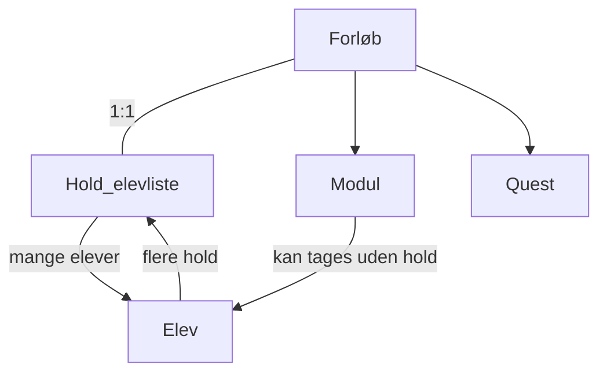
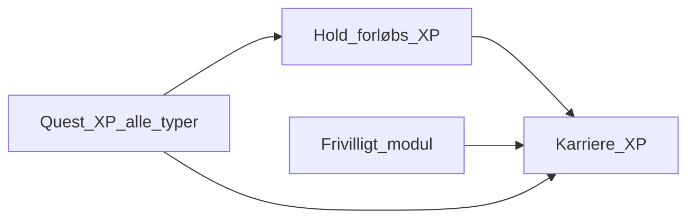

# Domæne-model

Fælles ordliste for Mercantec.tech — aftalt i feature-afklaringen. Feature-katalog: [[Feature-oversigt]].

## Begreber

| Begreb | Betydning |
|--------|-----------|
| **Modul / blok** | Ét fagligt indslag. Kan indgå i et forløb **eller** tages frivilligt uden hold → XP til karriere. |
| **Forløb** | Faglig ramme (fx H3, Game Design, valgfag). Indeholder moduler og quests. |
| **Hold** | Kun elevliste. **1:1 med forløb** (ét forløb = ét hold). Elev kan være på flere hold. |
| **Optag** | Primært fra Lectio; manuel tilføjelse i platformen som supplement. |
| **Underviser / elev** | To forskellige views. Rolle fra Mercantec Auth og/eller sat i platformen. |
| **Hold-/forløbs-XP** | XP tjent inden for et konkret forløb/hold. |
| **Karriere-XP** | Samlet XP (hold + frivillige moduler + quests m.m.). Alt quest-XP tæller med. |
| **Main quest** | Obligatorisk på forløbet (fx delafleveringer). |
| **Side / Daily quest** | Frivillige; ekstra XP (tæller også til karriere). |
| **Aflevering** | Skoleopgave/quest-krav i systemet (link, video, fil m.m.). |
| **Projekt** | Dedikeret showcase (solo/gruppe) — **adskilt** fra quest-aflevering. |
| **Logbog** | Elevens løbende refleksion; synlig for underviser. |

## Relationer

## XP-lag

## Relateret

- [[Platform-vision]]
- [[Feature-oversigt]]
- [[Ansvarsområder]] — Lectio under Integrationer
- [[Relaterede-projekter]] — Lectio-Collector
