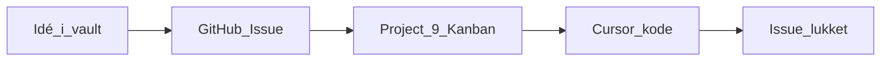

# GitHub Issues og Projects

Hele vores arbejdsflow for Mercantec.tech (og beslægtet arbejde under Mercantech) kører via **GitHub Issues** + **GitHub Projects**.

## Board

- Org-project (Kanban): [Mercantech Projects #9](https://github.com/orgs/Mercantech/projects/9/views/1?system_template=kanban)
- Issues oprettes i det relevante repo (fx `Mercantec.tech`) og tilføjes til boardet.

## Principper

1. **Issue = én opgave** — konkret, handlingsbar, med acceptkriterier når det giver mening.
2. **Board = sandhed for status** — flyt kortet når status ændrer sig; undgå parallelle “todo”-lister uden for GitHub.
3. **Obsidian planlægger, Issues eksekverer** — vision, ADR og AI-workflows lever i vaulten; konkret arbejde lander som Issues på boardet.
4. **Ansvar** — assign til MAGS eller KASC efter [[Ansvarsområder]] (Auth, Deploy, Design, Sikkerhed, Integrationer m.m.).

## Typisk flow

1. Idé / feature noteres evt. i [[Feature-oversigt]] eller en [[Feature-plan]].
2. Opret **Issue** med titel, kontekst, links til vault-noter og evt. Lectio/Auth-afhængigheder.
3. Tilføj Issue til [Project #9](https://github.com/orgs/Mercantech/projects/9/views/1?system_template=kanban) og sæt status (kolonne).
4. Arbejd i Cursor efter [[Cursor-arbejdsgang]]; referér Issue-nummer i commits/PR når I bruger dem.
5. Flyt kortet undervejs; luk Issue når acceptkriterier er opfyldt.

## Hvad hører hvorhen

| Sted | Bruges til |
|------|------------|
| [[Feature-oversigt]] / vault | Retning, beslutninger, AI-prompts |
| GitHub Issue | Konkret opgave, diskussion, assignees |
| Project #9 | Prioritering og status på tværs |

## For AI (Cursor)

- Før større arbejde: tjek om der allerede findes et Issue; ellers foreslå at oprette et og lægge det på Project #9.
- Opdater ikke board-status uden at I beder om det (kræver typisk `gh` / GitHub-adgang med project-scopes).
- Link Issues i chat og i vault-noter med fuld URL eller `org/repo#nummer`.

## Relateret

- [[Cursor-arbejdsgang]]
- [[Ansvarsområder]]
- [[Feature-oversigt]]
- [[Start her]]
