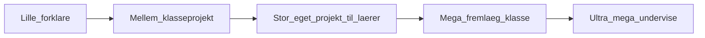

# Emne-badges

Custom badges knyttet til et **specifikt emne** (fx et modul, teknik eller fagligt tema). Underviser/design laver badge’et; progressionen er den samme for alle emner.

## Niveauer (lille → ultra mega)

| Niveau | Kort navn | Eleven kan… |
|--------|-----------|-------------|
| 1 | **Lille** | Forklare om emnet |
| 2 | **Mellem** | Fremlægge et **klasseprojekt** om emnet |
| 3 | **Stor** | Fremlægge et projekt eleven har **arbejdet på selv** for læreren |
| 4 | **Mega** | Fremlægge om emnet **for klassen** |
| 5 | **Ultra mega** | Holde oplæg og **undervise** om emnet |

## Progression

Hvert niveau forudsætter typisk det forrige **inden for samme emne** (lille → mellem → …). Et emne har op til fem badges (eller ét badge med fem ranks — se beslutning nedenfor).

## Custom pr. emne

1. Vælg/definér **emne** (navn + evt. forløb/modul).
2. Design badge-variant (KASC) — gerne samme form, forskellig ikon/farve pr. emne; størrelse/rank synlig i UI.
3. Opret noter i `katalog/` med skabelon [[Badge]] (type: `emne`, felt Niveau + Emne).
4. Tilføj række i [[Badge-oversigt]].

## Model (arbejdsvalg)

**Ét badge-id pr. emne + niveau** (fx `emne-git-lille`, `emne-git-mega`) — klart til tildeling og væg. Alternativ “ét badge med rank” kan overvejes senere; vi starter med separate niveauer.

## Bedømmelse

Typisk **underviser-godkendelse** efter fremlæggelse/demonstration (kobles til quest/aflevering eller manuel tildeling). Detaljer pr. emne i katalog-noten.

## Relateret

- [[Sammenhæng]]
- [[Badge-oversigt]]
- [[Levels-XP-Badges]]
- [[Karakter-og-certifikatvæg]]
- [[Quests-og-planner]]
