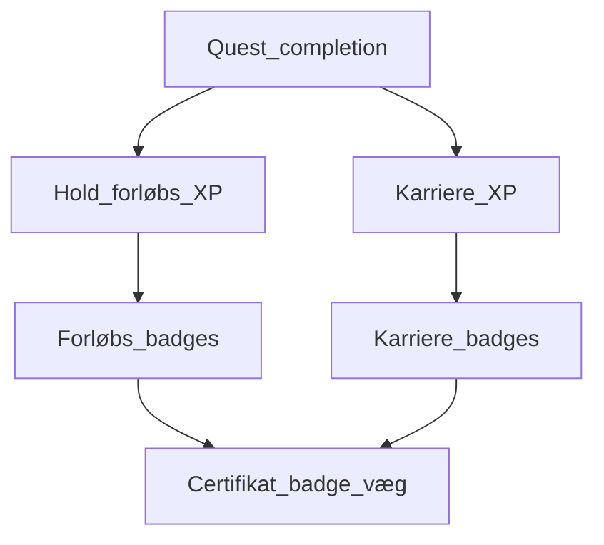
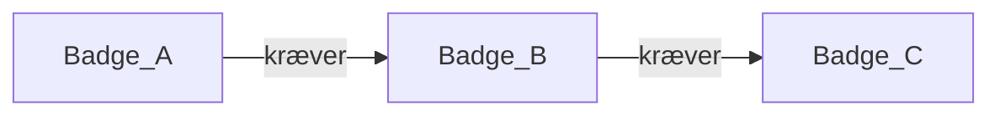

# Badge-sammenhæng

Hvordan badges relaterer til hinanden og til XP, quests og forløb. Opdater når I definerer konkrete badges.

## Lag

## Regler (aftalt / under udfyldning)

1. Badges kan knyttes til **hold-/forløbs-XP**, **karriere-XP**, konkrete **quests**, eller **særlige handlinger** (fx første projekt).
2. Nogle badges kan have **forudsætninger** (andre badges eller min. level) — tegn dem herunder når de findes.
3. Visning: legende karakter + **professionel væg** ([[Karakter-og-certifikatvæg]]).

## Forudsætnings-træ

Udfyld når kataloget har konkrete badges:

*(Erstat med rigtige badge-navne og wikilinks.)*

## Kobling til features

| Fra | Til badges |
|-----|------------|
| [[Levels-XP-Badges]] | Tildelingsregler, levels |
| [[Quests-og-planner]] | Quest-badges / milestones |
| [[Projekter-Steam-galleri]] | Evt. showcase-badges |
| [[Logbog]] | Evt. refleksions-badges |

## Relateret

- [[Badge-oversigt]]
- [[Levels-XP-Badges]]
