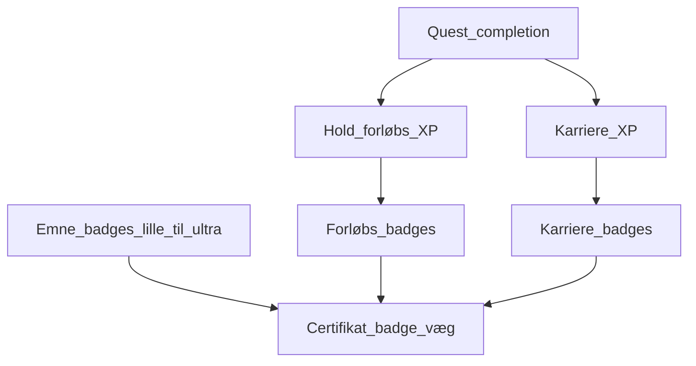
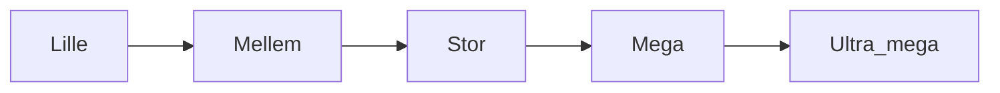

# Badge-sammenhæng

Hvordan badges relaterer til hinanden og til XP, quests og forløb.

## Lag

## Emne-badges (primær stige)

Se [[Emne-badges]]. Custom badge pr. emne; fem niveauer:

**Lille** (forklare) → **Mellem** (klasseprojekt) → **Stor** (eget projekt til lærer) → **Mega** (fremlæg for klassen) → **Ultra mega** (undervise om emnet).

## Regler

1. Badges kan knyttes til **emne-niveauer**, **hold-/forløbs-XP**, **karriere-XP**, **quests**, eller særlige handlinger.
2. Emne-niveauer forudsætter typisk forrige niveau **samme emne**.
3. Visning: legende karakter + **professionel væg** ([[Karakter-og-certifikatvæg]]).
4. Tildeling af emne-badges: typisk underviser efter demonstration/fremlæggelse.

## Kultur-badges (ingen stige)

Frivillige / stemnings-badges uden forudsætningskæde — typisk underviser-tildeling:

- [[Hawaii-skjorte]] — hawaii-skjorte
- [[Fancy-Friday]] — Fancy Friday

## Andre forudsætnings-træer

Udfyld når der kommer flere ikke-emne-badges med kæder.

## Kobling til features

| Fra | Til badges |
|-----|------------|
| [[Emne-badges]] | Emne-stige lille→ultra mega |
| [[Levels-XP-Badges]] | Tildelingsregler, levels |
| [[Quests-og-planner]] | Quest kan pege på emne-niveau |
| [[Projekter-Steam-galleri]] | Evt. dokumentation til Stor/Mega |
| [[Logbog]] | Evt. refleksion før Lille |

## Relateret

- [[Badge-oversigt]]
- [[Emne-badges]]
- [[Levels-XP-Badges]]
